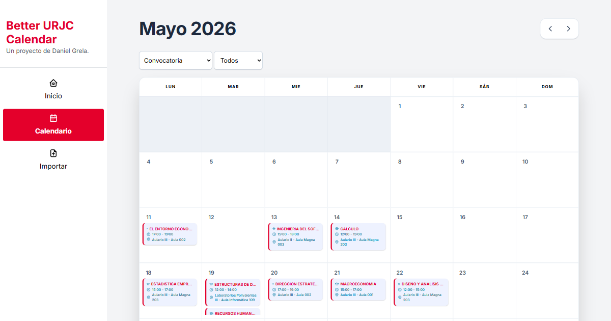

# Better URJC Calendar

El Excel oficial de exámenes de la URJC, convertido en un calendario que se entiende de un vistazo.

**[betterurjccalendar.danielgrela.com](https://betterurjccalendar.danielgrela.com/)**



## Qué hace
- **Calendario personal**: rejilla mensual en el ordenador (con ← y → para cambiar de mes) y lista por meses en el móvil, con buscador de asignatura y filtros por convocatoria y por exámenes pendientes.
- **Próximos exámenes** con la cuenta atrás de cada uno.
- **Aviso de solapamientos**: marca los exámenes cuyas horas se cruzan y los que caen el mismo día.
- **Exportación** a Excel (`.xlsx`) y a iCal (`.ics`) para Google Calendar, Outlook o el calendario del móvil, con la hora de Madrid y el recordatorio que elijas (1 día antes, 2 horas antes o ambos). Si la URJC cambia un examen, volver a importar el `.ics` en tu calendario actualiza el evento en vez de duplicarlo. También se puede añadir un examen suelto a Google Calendar o **imprimir** la lista (o guardarla en PDF).
- **Importación** del Excel de la URJC o de un `.ics`. Al volver a importar, avisa de qué exámenes han cambiado de fecha, hora o aula.
- **Tus asignaturas**: oculta las que no te interesan, elige tu grupo y marca cada examen como aprobado (se ocultan sus convocatorias posteriores) o «No me presento» (no se exporta).
- **Carga de estudio**: cuántos días tienes para preparar cada examen pendiente y cuál es tu semana más cargada.
- **Exámenes propios**: en **Crear** añades a mano los que no estén en el Excel (curso, plan y franjas horarias se rellenan de un toque con lo que ya tienes) y se mantienen aunque importes otro archivo. Cualquier examen, importado o propio, se puede editar o eliminar desde su menú «⋯» (eliminar se puede deshacer).
- **Compartir y copia de seguridad**: pasa tu calendario a un compañero con un enlace o un QR, o descarga una copia `.json` con todo (también tus ajustes) para llevarla a otro navegador.
- **Modo claro y oscuro** (la primera vez, el de tu sistema; después, el que elijas) y **funciona sin conexión** como PWA una vez cargada.

## Cómo se usa
1. Entra en [servicios.urjc.es/examenes](https://servicios.urjc.es/examenes/alumno/login) con tus credenciales de la URJC y pulsa «Descargar en Excel».
2. En la app, ve a **Importar** y arrastra o elige el archivo. También vale un `.ics`: el que exporta la propia app conserva todos los datos, así que sirve para pasar tus exámenes a otro dispositivo.
3. Pulsa «Importar»: te lleva al Calendario, y en Inicio verás los próximos exámenes.

La [guía de uso](https://betterurjccalendar.danielgrela.com/dashboard/guia-de-uso) lo explica con capturas y ofrece un [Excel de ejemplo](public/Examenes.xlsx) para probarla.

## Privacidad
Todo ocurre en tu navegador: el Excel no se sube a ningún servidor, no hay cuentas ni analítica. Los exámenes importados y tus ajustes se guardan en el `localStorage` de tu navegador y puedes borrarlos desde Importar.

Al compartir el calendario, los exámenes viajan comprimidos **dentro del propio enlace** (tras el `#`, que el navegador no envía al servidor): no se suben a ninguna parte, pero cualquiera que tenga el enlace o el QR puede verlos. Solo se comparte lo que ves en tu calendario, sin tus estados (aprobado, no me presento).

## Desarrollo
Requiere Node.js 20.19+ o 22.12+ (lo que pide Vite 8).

```sh
npm install
npm run dev        # http://localhost:5173
```

| Comando | Qué hace |
|---|---|
| `npm run host` | Igual que `dev`, accesible desde otros dispositivos de la red (para probar en el móvil) |
| `npm run build` | Sitio estático en `dist/client` (prerenderiza la portada y la guía de uso) |
| `npm run preview` | Sirve el build en http://localhost:4173 como lo haría Vercel |
| `npm run typecheck` | Tipos de las rutas + `tsc` |
| `npm run lint` | ESLint |
| `npm test` | Tests de la lógica (Vitest) |

Hecho con React 19, React Router 7 (modo framework, sitio estático), Vite, Tailwind CSS 4, Zustand y TypeScript. Se despliega en Vercel desde `main`.

Para contribuir: [`DESIGN.md`](DESIGN.md) recoge la guía visual (tokens de color, contraste y componentes).

## Créditos
- Creado por [Daniel Grela](https://www.danielgrela.com).
- Iconos de [Tabler Icons](https://tabler.io/icons) y fuente [Inter](https://rsms.me/inter/).
- Lectura y escritura de Excel con [read-excel-file](https://gitlab.com/catamphetamine/read-excel-file) y [write-excel-file](https://gitlab.com/catamphetamine/write-excel-file); iCal con [ics](https://github.com/adamgibbons/ics); códigos QR con [uqr](https://github.com/unjs/uqr).

Proyecto independiente, sin relación oficial con la Universidad Rey Juan Carlos.

## Licencia
Copyright © 2026 Daniel Grela.

Software libre bajo la [GNU General Public License v3.0](LICENSE): puedes usarlo, estudiarlo, modificarlo y compartirlo, siempre que las versiones que distribuyas sigan siendo código libre con la misma licencia.
